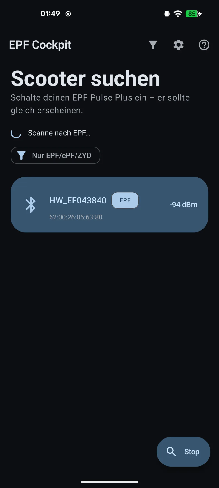
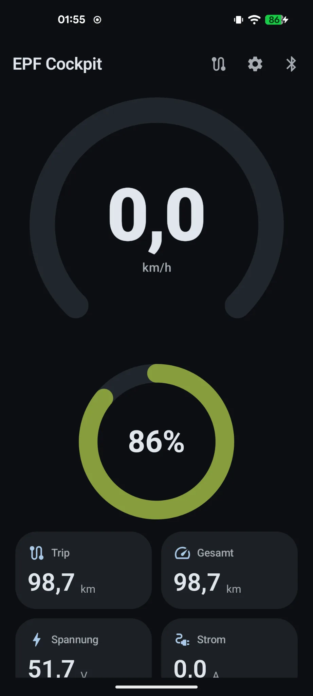
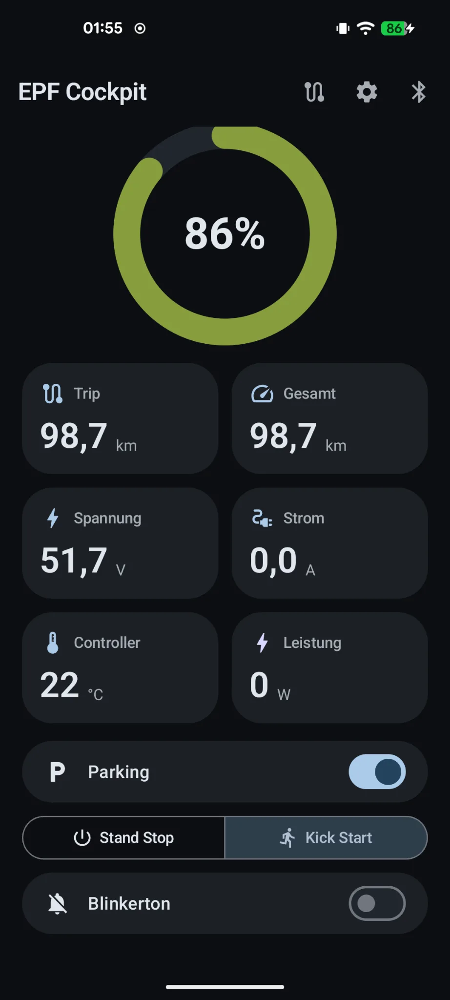
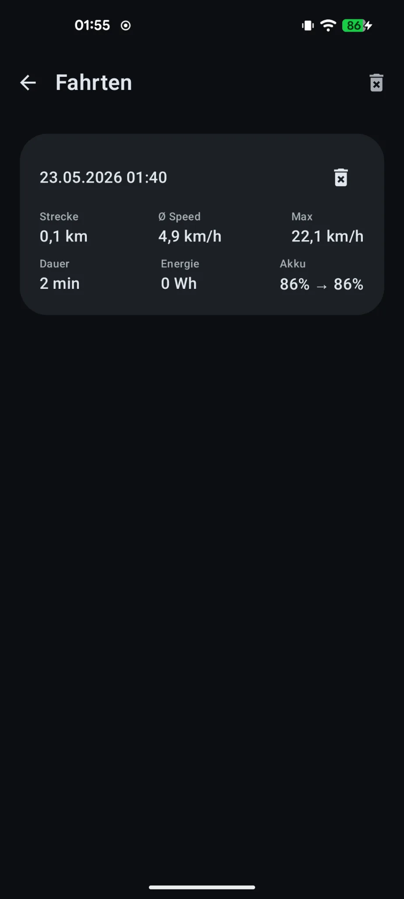
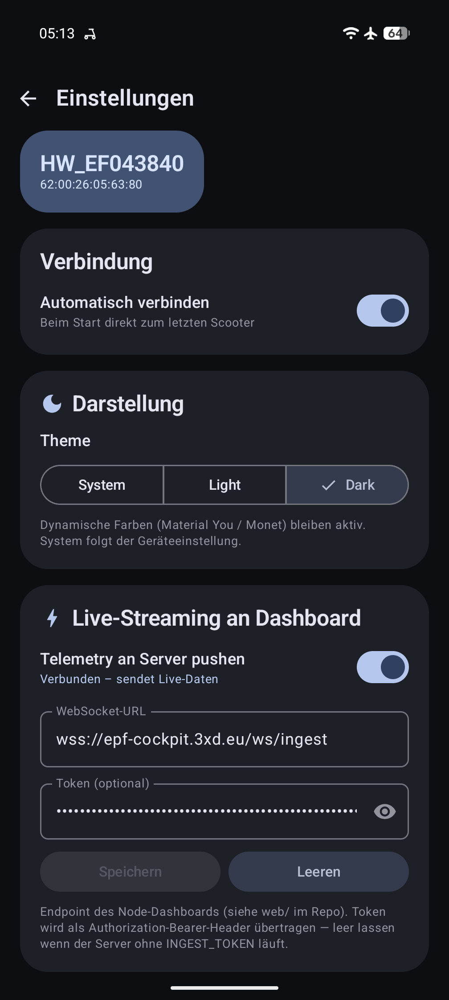
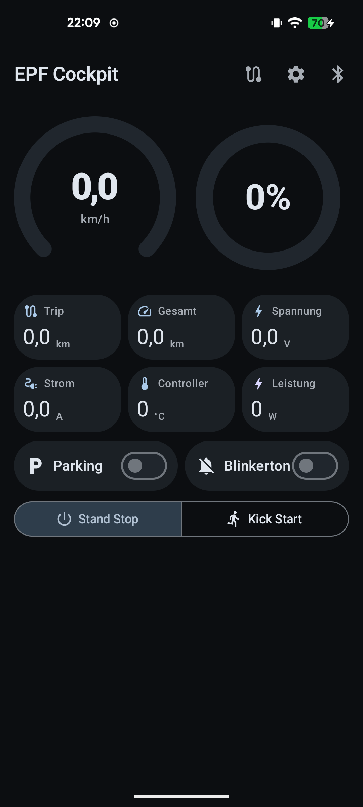
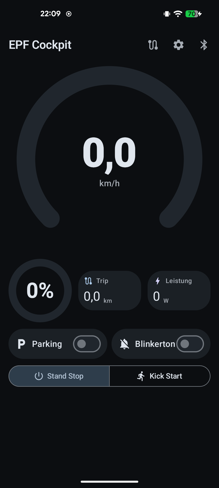
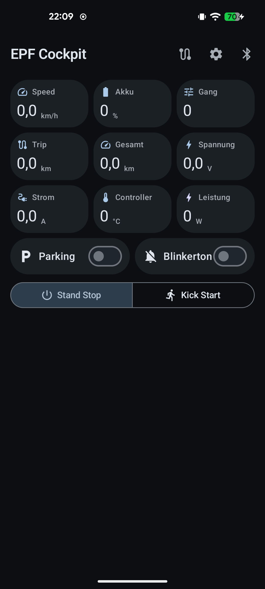

# EPF Cockpit

Alternative Open-Source-App für ePowerFun-Scooter — verifiziert auf dem **EPF
Pulse Plus** (Hobbywing-Controller, `L10_C1EPULSE`). Verbindet sich per Bluetooth
Low Energy mit dem Scooter, authentifiziert sich mit der PIN und zeigt
Live-Telemetrie sowie sniff-verifizierte Steuer-Funktionen in einem
Material-3-Expressive-Dashboard mit dynamischem Farbschema.

## Features

### Dashboard
- Großer Tacho-Ring mit animiertem Sweep-Gradient
- Akku-Ring mit Farbwechsel (rot → orange → grün)
- Live-Leistung (Watt = U·I), Rekuperations-Anzeige
- Spannung, Strom, Controller-Temperatur, Trip- und Gesamt-Kilometer
- Bildschirm bleibt im Cockpit an (kein versehentliches Dimmen während der Fahrt)
- **Layout-Switcher** (Settings): vier Dashboard-Layouts — **Standard** (großer
  Tacho + Akku, scrollbar), **Kompakt** (alle Werte ohne Scrollen auf einem
  Screen), **Fahrt** (riesiger Tacho + Akku, minimale Kacheln) und **Daten**
  (nur Zahlen, keine runden Anzeigen). Jeweils für Hoch- und Querformat,
  persistent über App-Neustart.

### Steuerung (sniff-verifiziert für Pulse Plus)
- **Parking** ein/aus — Material-3-Switch, sniff-verifizierte Frames
- **Modus Stand Stop ↔ Kick Start** — Segmented Button, persistent über
  App-Neustart
- **Blinkerton** ein/aus — Sprach-/Ton-Hinweise, Status wird live vom Scooter
  gelesen
- **Frontlicht** ein/aus — Schalter im Dashboard (nur entsperrt; geparkt
  ignoriert der Controller das Licht und schaltet es beim Parken selbst ab),
  Zustand wird live aus der Telemetrie gelesen
- **Licht-Merker** — die App merkt sich, ob das Frontlicht bei entsperrtem
  Roller an war, und stellt es beim Entsperren bzw. Wiederverbinden wieder her
  (12 Stunden gültig, übersteht App-Neustart)
- **Tageskilometer zurücksetzen** (Settings → Roller, mit Rückfrage, nur im
  Stand) — setzt den Trip-Zähler am Roller auf 0
- **Max-Geschwindigkeit** — Slider 1..30 km/h in den Settings, schickt einen
  `AF`-Stand-Stop-Frame mit dem neuen `g3`-Wert an den Controller. Apply-Button
  ist nur bei aktiver Verbindung + P-Modus enabled. **Echo-Sync**: der Roller
  spiegelt seinen aktuellen `g3` im Echo-Frame zurück, App synct davon → keine
  Drift wenn die offizielle EPF-App parallel den Wert ändert. Ab 21 km/h zeigt
  der Slider eine orange "EXPERIMENTELL"-Markierung — der Hobbywing-Controller
  cappt aktuell bei 22 km/h, höhere Werte landen byteweise korrekt am
  Controller, werden aber clamped (live verifiziert: Echo zeigt 22 nach
  Anfrage 23). Frames mit CRC little-endian (Hobbywing-Konvention, weicht
  von ZydDash big-endian ab — kostete ein paar Stunden Debugging).

### Verbindung
- BLE-Scan mit Filter auf `HW_*` / `ePF*` / `EPF*` / `ZYD*`, sortiert nach RSSI
- 6-stellige PIN-Authentifizierung via `AT+PWD[…]`, optional gespeichert
- **Zweiphasiger Auto-Reconnect**: erst direkter Connect auf gespeicherte MAC
  (≤6 s), dann Scan-by-Name (≤15 s, robust gegen Privacy-MAC-Rotation),
  danach manueller Scan-View
- **Reconnect im Hintergrund**: reißt die Verbindung bei gesperrtem Handy ab
  (z.B. geparkt, außer Reichweite), wartet die App bis zu 2 h auf den Roller
  und verbindet selbst neu — ohne App-Öffnen. Bei entsperrtem Handy mit
  anderer App vorne bleibt der Funk frei, damit z.B. die Hersteller-App den
  Roller findet (abschaltbar: „Bei gesperrtem Handy neu verbinden“)
- Nach manuellem „Trennen" (Dashboard oder Notification) kein Auto-Reconnect
  mehr in der gleichen App-Session
- Friendly Error-Wording für GATT-Status-Codes
- Connection bleibt stabil dank des sniff-verifizierten `A5 02 FD 5A`
  Heartbeat alle 600 ms

### Persistenz
- Letzter Scooter wird gemerkt (DataStore), Auto-Reconnect beim App-Start
- Fahrten-Logging in Room: Strecke, Ø/Max-Geschwindigkeit, Energie, Akku-Verbrauch
- Letzter Ride-Modus wird gespeichert und beim Start wiederhergestellt

### Background-Lifecycle
- **Foreground-Service** mit Live-Notification (km/h + Akku + Watt) hält die
  BLE-Verbindung am Leben, auch wenn der Screen aus geht oder du wegnavigierst
- **Trip-Recording** läuft im `@Singleton`, überlebt Screen-Navigation —
  startet mit dem ersten Telemetry-Frame nach Connect, finalisiert auf Disconnect
- **Exit-on-Swipe**: wenn du die App aus den Recents wegwischst, killt der
  Service sich + den Prozess komplett (kein lingering BLE-Heartbeat)
- **Startup-Onboarding**: einmaliger Dialog fragt POST_NOTIFICATIONS +
  Akku-Optimierung-aus ab, damit der FGS nicht von Doze gekillt wird

### Design
- **Material 3 Expressive** mit dem neuen Type-Scale und größeren Corner-Radii
- **Dynamic Color** (Monet) ab Android 12 — App-Farben folgen dem Wallpaper
- Edge-to-Edge, animierte Übergänge, M3-Wavy-Indicators
- Light / Dark / System Theme manuell wählbar (Settings)
- Eigenes App-Icon + Splashscreen (E-Scooter-Glyph, Dark-Teal)

### Live-Streaming → Web-Dashboard
- Optional pusht die App Telemetry per WebSocket an einen kleinen Node-Server
  (siehe [`web/`](web/)) — daraus entstehen drei Browser-Views:
  Live-Dashboard mit Charts + Live-Karte, OBS-Studio-Widget (transparent)
  und Trip-Historie mit Routen-Karten.
- **Live-Dashboard** (`/`): Tile-Grid (Speed/Akku/Leistung/Spannung/Strom/
  Controller) mit Lucide-Style SVG-Icons + drei uPlot-Charts (Geschwindigkeit
  + Leistung + Akku). Charts haben Hover-Tooltips mit Zeit + Wert am Cursor
  und einen Zeitraum-Selector (Live 5m / 15m / 1h / 6h / 24h / 7d) der
  zwischen Live-Buffer und Server-Range-Query (mit Bucket-Downsampling)
  switcht. **Mausrad-Zoom**: im Live-Mode schrumpft das Anzeige-Fenster
  (15..300 s), in History cursor-zentriert zoom auf alle drei Charts
  synchron; Doppelklick = Reset.
- **Live-Map** (Leaflet, OSM/Esri-Satellit/OpenTopoMap-Layer-Switcher):
  zeigt die Roller-Position live mit Marker + Breadcrumb-Trail. Trail wird
  beim Tab-Open mitten in der Fahrt vom Server nachgeladen
  (`/api/trips/:id/locations`), also keine Lücke. Smart Auto-Follow
  pausiert nach User-Interaktion (10 s) und springt zurück sobald der
  Marker außerhalb des sichtbaren Bereichs landet. Satellit ist Default,
  vertikaler Zoom-Slider links, Layer-Switcher rechts oben.
- **Anzeigename-Sync**: vom User in den App-Settings vergebener Roller-Name
  wird im `hello`-Frame mitgeschickt und serverseitig pro MAC gespeichert.
  Neues Smartphone holt den Namen automatisch vom Server (`GET
  /api/scooter-name`) — kein Re-Tippen nötig. Fallback "E-Scooter
  verbunden" wenn nichts gesetzt.
- **Trip-History** (`/history`): expandierbare Karten je Fahrt mit
  Strecke / Dauer / Max / Ø-Speed / Energie und uPlot-Chart mit zwei
  Y-Achsen (km/h teal + Akku % amber) on-Demand. Wenn GPS-Waypoints für
  die Fahrt aufgezeichnet wurden, gibt es zusätzlich eine eingebettete
  Leaflet-Karte mit der Route (Start/Ende-Marker). Zeitraum-Chips (Heute
  / 7 Tage / 30 Tage / Diesen Monat / Dieses Jahr / Alle) plus **Eigener
  Zeitraum** mit Date-Picker. Aggregat-Stats (Anzahl · km · Fahrzeit ·
  Energie) für den aktiven Filter live in der Filter-Leiste.
- **OBS-Widget** (`/obs`): minimales transparentes Overlay mit Speed / Akku /
  Watt für Streaming-Captures (`?theme=…&accent=…&compact=…`-Query-Params).
- **Sprache**: Komplett auf Deutsch übersetzt inkl. korrekter Umlaute, EU-
  Datum (`22.05.2026`) + 24h-Zeit überall (auch in den Chart-Achsen).
- **Backfill**: Nach jedem Reconnect schickt die App die Trips nach, die der
  Server noch nicht quittiert hat (`trip_end` mit deterministischer ID
  `local-<rowId>`, Antwort `trip_ack`). Idempotent, Mehrfach-Sends sind OK.
- **Shared-Token-Auth**: `INGEST_TOKEN` (App→Server) + `VIEW_TOKEN`
  (Server→Browser), beide optional, konstant-zeitig verglichen
  (`crypto.timingSafeEqual`). Token in der App wird als
  `Authorization: Bearer …` übertragen, landet nicht in Server-Logs.
- **Cache-Strategie**: eigene Assets (`/dist`, `/css`, `/js`) → ETag-
  Revalidation ohne `max-age`, HTML → `no-cache, must-revalidate`, Vendor
  (uPlot) → 7d immutable. Damit landen `npm run build`-Updates sofort
  beim nächsten Reload, kein Ctrl+F5 nötig.
- Server-URL + Token + Enable-Switch in den App-Settings.

### Standortverfolgung (optional, ohne Google-Dienste)
- Strikt AOSP über `LocationManager.GPS_PROVIDER` (Fallback `NETWORK_PROVIDER`
  wenn GPS aus ist) — kein FusedLocationProvider, keine Google Play Services.
  1-Sekunden-Intervall während aktiv.
- **Trip-Modus**: GPS läuft nur während eine Fahrt aktiv ist (Trip in Room
  registriert + Roller nicht geparkt). Jeder Sample wird persistent in
  `trip_locations` gespeichert UND live ans Dashboard gepusht. Route ist
  hinterher in der Trip-Detail-Karte sichtbar (Leaflet + Start/Ende-Marker).
- **Idle-Modus** (opt-in zweiter Toggle): wenn aktiviert, läuft GPS auch
  wenn gerade keine Fahrt läuft — nur live ans Dashboard, ohne DB-Persistenz.
  Praktisch um die Roller-Position am Live-Map zu sehen ohne extra Akku-
  Verbrauch durch Trip-Logging.
- **Provider-Change-Receiver**: wenn der User GPS in den System-Settings
  nachträglich aktiviert, startet der Listener automatisch nach.
- **Backfill**: GPS-Waypoints werden mit `trip_end` als `locations[]` an
  den Server mitgeschickt — selbst wenn der WebSocket während der Fahrt
  Drops hatte, kommt die komplette Route nach.

### Quick-Tile + Home-Screen-Widget
- **Quick-Tile** in den Schnelleinstellungen: 1-Klick Entsperren/Sperren.
  Status (Verbunden? Geparkt?) wird live vom FGS gepusht, Untertext zeigt
  "Entsperren" / "Sperren" / "Verbinden".
- **Quick-Tile „E-Scooter Licht“**: Frontlicht ein/aus (geparkt ausgegraut,
  getrennt verbindet ein Tipp).
- **Home-Widget** (3×1) mit zwei Buttons: **Entsperren ↔ Sperren** (Label
  flippt nach Park-Zustand) und **Modus: Stand / Kick** (toggle). Updates
  bei jedem Telemetrie-Frame, also fast live.
- Tile- oder Widget-Klick im getrennten Zustand verbindet nur (ohne Park-
  Befehl — der Park-Zustand ist dann unbekannt). Befehle bei laufendem
  Verbindungsaufbau warten bis zu 20 s auf BLE-Auth — funktioniert also auch
  wenn du nur die Tile/Widget vom Lockscreen tippst.

### NFC-Diagnose + Magic-NTAG215-Klon
- **Diagnose-Read**: Einstellungen → "NFC-Diagnose" → "Tag scannen". Liest
  NTAG2xx / Mifare-Ultralight-Tags und zeigt UID + Tech-Liste + kompletten
  Hex-Dump aller Pages (NTAG213/215/216). Heuristik schlägt den Tag-Typ
  vor, Copy-Buttons für UID und Hex-Dump. Reader-Mode mit Foreground-
  Dispatcher, kein Schreiben — rein read-only.
- **Magic-NTAG215-Klon**: Vom Diagnose-Screen "UID auf Magic-Tag schreiben",
  schreibt die 7-Byte UID auf einen Magic-NTAG215 (Gen2 / UID-changeable).
  BCC0/BCC1 werden automatisch berechnet. Normale Werks-NTAGs werfen einen
  Schreibfehler — nur Magic-Tags mit beschreibbarer Page 0–2 funktionieren.
- Use-Case: Klone die Original-Roller-NFC-Karte auf eine Reserve-Karte,
  damit du nicht nur eine einzige hast. (Phone selbst als NFC-Tag
  emulieren geht hardwarebedingt NICHT — Android-HCE unterstützt nur
  Type-4-Tags, NTAG215 ist Type-2.)
- Produktion: nginx-Reverse-Proxy + gehärteter systemd-Service, fertige
  Configs unter [`web/deploy/`](web/deploy/).
- Details: [`docs/STREAMING.md`](docs/STREAMING.md) (Protokoll, Auth-Modell,
  Troubleshooting) und [`web/deploy/README.md`](web/deploy/README.md)
  (Schritt-für-Schritt-Deployment auf 3dns.eu).

## Download

📦 **Aktuelle Nightly:** [epf-cockpit-nightly-0.1.0.apk](https://git.3dns.eu/dom1nic/epf_cockpit_android/releases/download/nightly/epf-cockpit-nightly-0.1.0.apk)
🗂 **Alle Releases:** [git.3dns.eu/dom1nic/epf_cockpit_android/releases](https://git.3dns.eu/dom1nic/epf_cockpit_android/releases)

Nightlies werden automatisch nach jedem Push auf `main` gebaut, sind mit dem
Release-Keystore signiert und ersetzen eine bestehende Installation in-place.

## Screenshots

| | |
|---|---|
|  |  |
| Scan: BLE-Suche mit EPF/ePF/ZYD-Filter, Live-RSSI | Dashboard: Speed-Ring + Akku-Donut + Stat-Tiles |
|  |  |
| Steuerung: Parking-Switch, Modus-Toggle, Blinkerton | Trips: Fahrtenliste mit Zeitraum-Filter + Aggregat-Stats |
|  |  |
| Settings: Theme + Layout-Switcher + Live-Streaming + Max-Geschwindigkeit | Layout **Kompakt**: alle Werte ohne Scrollen auf einem Screen |
|  |  |
| Layout **Fahrt**: riesiger Tacho + Akku, nur die wichtigsten Werte | Layout **Daten**: nur Zahlen, keine runden Anzeigen |

## Technische Dokumentation

Das BLE-Protokoll für den Pulse Plus wurde reverse-engineered, weil die
ZydDash-Doku (ePF-1) nur teilweise passt. Details in [docs/](docs/):

- [`docs/PROTOCOL.md`](docs/PROTOCOL.md) — Pulse-Plus-BLE-Protokoll im Detail:
  Services/Characteristics, Frame-Formate (AT, A5-Sync, AF-Control,
  AF-Telemetry), Heartbeat, Init-Burst, Status-Byte-Mapping, gefundene CRC-Variante
- [`docs/REVERSE_ENGINEERING.md`](docs/REVERSE_ENGINEERING.md) — Wie ich das
  rausgefunden habe: HCI-Snoop-Setup, Bug-Report-Pipeline, die vier Sniff-Runs,
  was jedes Mal geklärt wurde
- [`docs/ARCHITECTURE.md`](docs/ARCHITECTURE.md) — App-Architektur:
  Module, ViewModels, BLE-Layer, State-Flow, Auto-Reconnect-Logik
- [`docs/TROUBLESHOOTING.md`](docs/TROUBLESHOOTING.md) — Bekannte Probleme,
  Workarounds, Tipps zum Sniffen weiterer Funktionen

## Architektur (Kurzform)

```
ui/             — Compose-Screens (scan, auth, dashboard, settings, history)
ble/            — Protokoll-Layer + Nordic-BLE-Manager
   BleConstants     UUIDs, PIN-Default, advertising-Name-Prefixes
   Crc16Modbus      MODBUS-CRC mit BE/LE-Auto-Detect
   Telemetry        TelemetryDecoder.decode(frame) → Telemetry?
   ControlFrames    Frame-Konstanten + AT-Kommando-Builder
   ScooterManager   Nordic BleManager-Subklasse mit fire-and-forget Writes
   BleRepository   Singleton, Hilt-injizierbar, Connection-State-Flow,
                   Reconnect-Episode, Steuerbefehle
   HeartbeatController  Init-Burst + 600-ms-Heartbeat, adaptive WakeLock
   BleErrors        friendly error mapping
data/           — DataStore (Settings), Room (Trip-Historie)
di/             — Hilt-AppModule (Room-DB-Provider)
```

- **Compose** + **Material 3 Expressive** (`androidx.compose.material3:1.5.0-alpha`)
- **MVVM** mit Hilt-injizierten ViewModels, `StateFlow` als Observable State
- **Nordic Android BLE Library** kapselt GATT-Queue, Retries, Bonding-Fallen
- **Room** für Fahrten-Historie, **DataStore Preferences** für App-Settings

## Build

Voraussetzungen:
- JDK 21 (lokal + CI) — `source/target/jvmTarget = 21`
- Android SDK 37 (`compileSdk = 37`, `targetSdk = 36`, `minSdk = 31`)
- Gradle 9.7 via Wrapper (AGP 9.4)

```bash
./gradlew assembleDebug                 # Debug-APK
./release.sh release                    # Release-APK (macOS/Linux/WSL)
release.bat release                     # Release-APK (Windows)
```

Die Release-Skripte legen die fertige APK unter
`release/epf-cockpit-<version>-release.apk` ab.

### Signing (optional)

Lege `keystore.properties` (NICHT committen) an, basierend auf
[keystore.properties.example](keystore.properties.example). Ohne wird der
Release-Build mit dem Debug-Key signiert.

## Permissions

| Permission                                  | Zweck                                        |
|---------------------------------------------|----------------------------------------------|
| `BLUETOOTH_SCAN` (`neverForLocation`)       | BLE-Scan ohne Location-Pflicht               |
| `BLUETOOTH_CONNECT`                         | GATT-Connect, Notify-Subscriptions           |
| `POST_NOTIFICATIONS` (Android 13+)          | Foreground-Service-Notification mit km/h + Akku |
| `FOREGROUND_SERVICE_CONNECTED_DEVICE` (34+) | FGS-Type für laufende BLE-Verbindung im Hintergrund |
| `FOREGROUND_SERVICE_LOCATION` (34+)         | FGS-Type für GPS-Tracking während der Fahrt (nur runtime aktiv wenn Location-Permission granted) |
| `ACCESS_FINE_LOCATION` / `ACCESS_COARSE_LOCATION` | Optionales GPS-Tracking pro Trip (opt-in im Settings, AOSP-LocationManager) |
| `NFC`                                       | NFC-Diagnose-Tag-Read + Magic-NTAG215-Klon (install-time, kein Runtime-Prompt) |
| `REQUEST_IGNORE_BATTERY_OPTIMIZATIONS`      | Onboarding-Prompt: Akku-Optimierung aus, damit Doze den FGS nicht killt |
| `WAKE_LOCK`                                 | Kurze Partial-WakeLocks für Reconnect-Versuche im Hintergrund, Re-Auth nach Reconnect und (adaptiv) den Heartbeat bei Display aus |

## Was bewusst nicht geht

- **OTA-Firmware-Update**: Zu riskant ohne offizielle Signaturen.
- **Tuning über 22 km/h**: Der Max-Speed-Slider geht zwar bis 30, der
  Hobbywing-Controller cappt aber bei 22 km/h und verwirft höhere Werte
  silent. Ein echter Tuning-Bypass würde Eingriff in die Controller-Firmware
  bedeuten und ist in DE rechtlich problematisch — bewusst nicht angegangen.
- **Cloud-Sync / Account**: Bewusst weggelassen, offline-only. Live-Streaming
  läuft optional zu deinem eigenen Self-Hosted Node-Server.

## Quellen

- ZydDash BLE-Telemetry-Doku (ePF-1, Zydtech): https://github.com/Ennar1991/ZydDash/blob/main/BLE_Telemetry.md
- Original Reverse-Engineering-Blog: https://www.irmo.de/2023/11/08/e-scooter-bluetooth-hacking/
- escooter-treff.de Forenthread: https://www.escooter-treff.de/threads/zydtech-controller-bluetooth-protokoll-reverse-engineering.12207/
- Offizielle ePowerFun-App (analysiert via Android HCI Snoop): `com.zydtech.epowerfun`

## Spenden

Das Projekt entsteht in der Freizeit und ist und bleibt Open Source. Wenn dir
EPF Cockpit gefällt und du die Weiterentwicklung unterstützen magst, freue ich
mich über eine kleine Spende:

💛 **PayPal:** [paypal.me/dom1nic](https://www.paypal.com/paypalme/dom1nic)

Danke! 🙏

## Autor

DoM!niC — [git.3dns.eu/dom1nic/epf_cockpit_android](https://git.3dns.eu/dom1nic/epf_cockpit_android)
